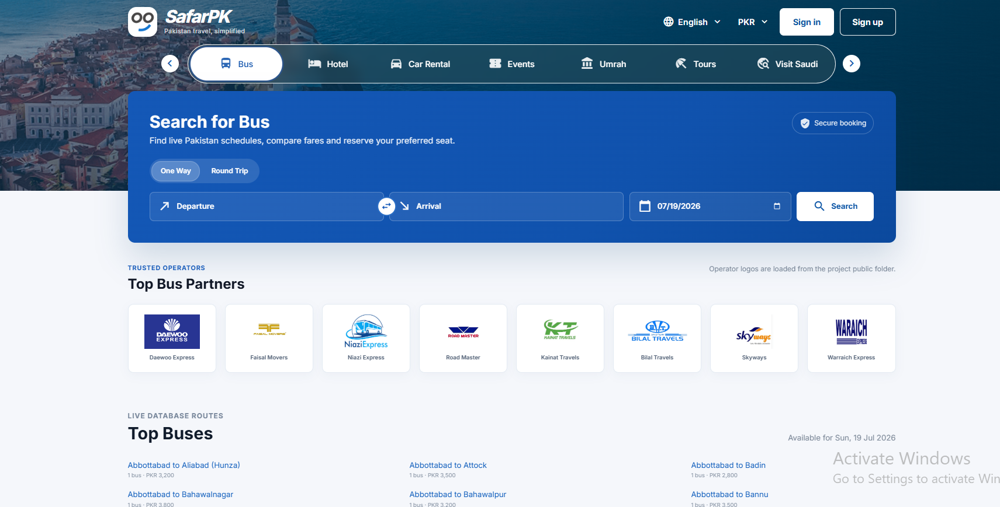
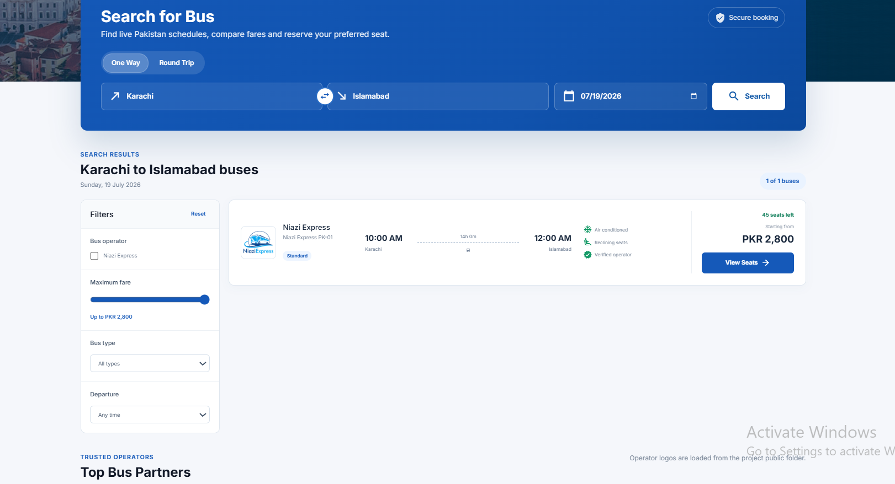
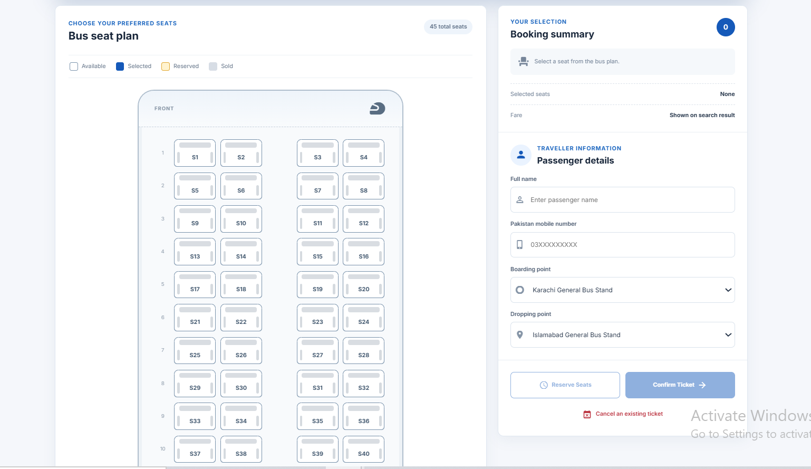
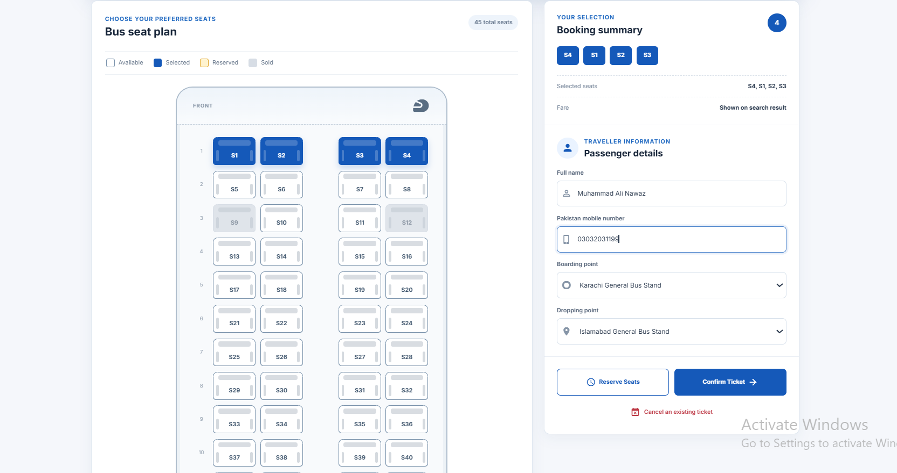
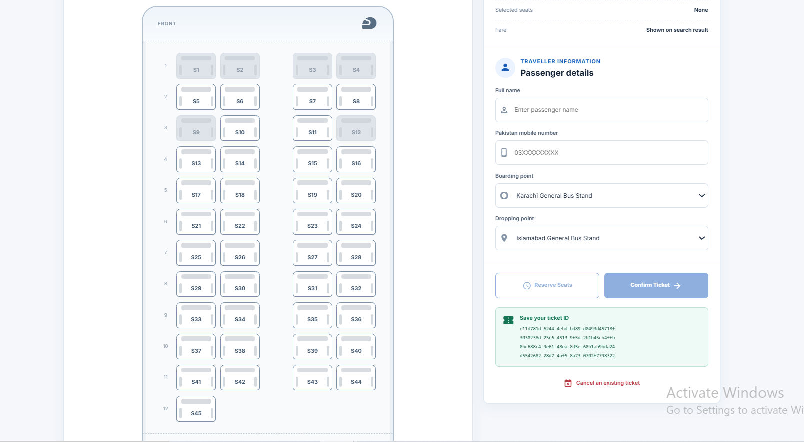
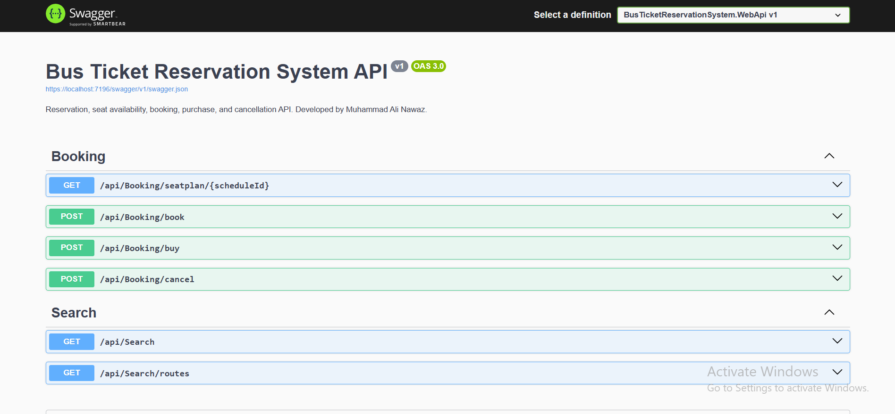

<h1 align="center">🚌 SafarPK — Bus Ticket Reservation System</h1>

<p align="center">
  <b>A responsive full-stack Pakistan bus-search, seat-reservation, ticket-purchase, and cancellation application built with ASP.NET Core 9 Web API, Angular 20, Entity Framework Core 9, PostgreSQL, TypeScript, Bootstrap, Swagger, and xUnit.</b>
</p>

<p align="center">
  
  
  
  
  
  
  
  
</p>

---

## 📸 Project Screenshots

| Home Page | Search Results |
|---|---|
|  |  |

| Seat Selection | Booking Form |
|---|---|
|  |  |

| Reserved Ticket | Swagger API Documentation |
|---|---|
|  |  |

---

## 🚀 Project Overview

**SafarPK** is a full-stack bus ticket reservation portfolio application focused on intercity travel across Pakistan. Passengers can browse dynamically available routes, search scheduled buses, compare fares and departure times, open a schedule-specific seat plan, reserve or purchase multiple seats, and cancel a ticket by proving ownership with the booking mobile number.

The application combines an **Angular 20 standalone frontend** with an **ASP.NET Core 9 Web API**, **Entity Framework Core 9**, and **PostgreSQL**. Its Bookme-inspired interface is implemented as an original portfolio design with SafarPK branding, responsive layouts, local bus-company assets, live API data, and safe loading, validation, empty, success, and error states.
---

## 🎯 Project Purpose

The project demonstrates how a practical transport-booking workflow can be implemented with a modern Angular client and a layered ASP.NET Core API.

It showcases:

- ASP.NET Core Web API development
- Angular standalone component development
- PostgreSQL persistence with Entity Framework Core
- Layered architecture and separation of concerns
- Repository and Unit of Work patterns
- Dynamic route and schedule discovery
- Schedule-specific seat availability
- Transactional multi-seat booking
- Concurrent double-booking protection
- Passenger-owned ticket cancellation
- Responsive, mobile-first interface design
- API documentation and automated backend testing

---

## ⭐ Key Highlights

- 🇵🇰 Pakistan-only demo network with 66 intercity destinations
- 🛣️ Dynamic database-backed route list with paging and optional filtering
- 🔎 Search by departure city, arrival city, and journey date
- 🚌 Bus cards with operator, logo, schedule, fare, duration, and seats remaining
- 💺 Schedule-specific seat-plan visualization
- 🎫 Reserve or purchase multiple selected seats in one transaction
- 🔁 Cancel a booking using ticket ID and original passenger mobile number
- ⚔️ Database-backed protection against concurrent double booking
- 📱 Responsive layouts for mobile, tablet, laptop, and wide desktop screens
- 🧭 Search results displayed before partner and route sections
- 🌐 Functional static English and PKR selectors
- 👤 Functional static sign-in and sign-up demonstration modals
- 🖼️ Local SafarPK and Pakistani bus-operator assets
- 📘 Swagger/OpenAPI documentation
- 💓 API health endpoint
- 🧪 19 focused xUnit tests
- 🔑 Secret-safe PostgreSQL configuration through .NET User Secrets

---

## ✨ Features

### 🔍 Route & Schedule Search

| Feature | Description |
|---|---|
| Pakistan Cities | Provides 66 major Pakistani intercity destinations |
| Dynamic Routes | Loads available routes from `GET /api/Search/routes` |
| Route Paging | Supports limit and offset values for loading more routes |
| Route Filtering | Supports optional route-text filtering |
| Direct Search | Searches buses using origin, destination, and journey date |
| Date Validation | Rejects missing and past journey dates using Pakistan local time |
| Result Filtering | Filters results by operator, maximum price, bus type, and departure window |
| Result Position | Displays bus results above Top Bus Partners and Top Buses |
| Route Shortcuts | Clicking a Top Buses route fills the search and loads live bus information |

### 💺 Seat Plan & Booking

| Feature | Description |
|---|---|
| Seat Plan | Loads seats for the selected bus schedule |
| Schedule Availability | A seat may be available on one schedule and occupied on another |
| Multi-Seat Selection | Allows one or more seats to be selected together |
| Reserve | Creates tickets with `Booked` status |
| Purchase | Creates tickets with `Sold` status |
| Passenger Validation | Requires passenger name and Pakistani mobile format `03XXXXXXXXX` |
| Route-Point Validation | Confirms boarding and dropping points belong to the schedule route |
| Wrong-Bus Protection | Rejects seats that do not belong to the scheduled bus |
| Duplicate Protection | Rejects duplicate seat IDs in one request |
| Transaction Safety | Commits all selected seats together or rolls the operation back |

### ❌ Cancellation

| Feature | Description |
|---|---|
| Ownership Check | Requires the ticket ID and original passenger mobile number |
| Forbidden Response | Rejects cancellation by a different mobile number |
| Repeated Cancellation | Returns a conflict when the ticket is already cancelled |
| Seat Reopening | Makes a cancelled seat available again on that schedule |
| Ticket Status | Preserves ticket history using `Booked`, `Sold`, and `Cancelled` states |

### 🎨 Frontend UI/UX

| Area | Implementation |
|---|---|
| Brand | SafarPK logo, title, favicon, navbar, and footer identity |
| Visual Direction | Original Bookme-inspired Pakistan bus-booking interface |
| Primary Theme | Blue booking surfaces, white cards, subtle borders, and neutral backgrounds |
| Navbar Selectors | Static but functional English and PKR dropdowns |
| Demo Authentication | Static sign-in and sign-up forms with local session feedback |
| Partner Logos | Uses local images from `frontend/public` |
| Search Form | One-way/round-trip controls, city swap, dates, and search action |
| Result Cards | Operator, logo, route, times, duration, availability, price, and seat action |
| Responsive Design | Grid/Flexbox layouts and media queries from small mobile to wide desktop |
| Accessibility | Semantic controls, labels, keyboard dismissal, focus states, and touch targets |

---

## 🛠 Technology Stack

| Layer | Technologies |
|---|---|
| Backend | .NET 9, ASP.NET Core Web API, C# |
| ORM | Entity Framework Core 9.0.10 |
| PostgreSQL Provider | Npgsql.EntityFrameworkCore.PostgreSQL 9.0.4 |
| Database | PostgreSQL 17 locally; PostgreSQL 14+ compatible design |
| API Documentation | Swagger / Swashbuckle 9.0.6 |
| Frontend | Angular 20 standalone components |
| Language | TypeScript 5.9 |
| Reactive Library | RxJS 7.8 |
| Forms | Angular template-driven forms |
| UI / Styling | CSS, Angular Material/CDK, Bootstrap 5.3, responsive Grid/Flexbox |
| Backend Testing | xUnit 2.9, Moq 4.20, EF Core InMemory |
| Tooling | Angular CLI 20.3, npm, pinned `dotnet-ef` tool manifest |

---

## 🏗 Architecture Overview

The backend follows a layered architecture that keeps domain rules, use cases, persistence, and HTTP concerns separate.

```text
Angular Frontend
      ↓ /api through Angular proxy
ASP.NET Core Controllers
      ↓
Application Services
      ↓
Repository Interfaces + Unit of Work
      ↓
EF Core / PostgreSQL Repositories
      ↓
PostgreSQL Database
```

### Layer Responsibilities

| Project | Responsibility |
|---|---|
| `BusTicketReservationSystem.Domain` | Entities, enums, value objects, and seat-state domain behavior |
| `BusTicketReservationSystem.Application.Contracts` | DTOs and repository/Unit of Work interfaces |
| `BusTicketReservationSystem.Application` | Search, seat-plan, booking, purchase, and cancellation use cases |
| `BusTicketReservationSystem.Infrastructure` | EF Core DbContext, mappings, migrations, repositories, and transactions |
| `BusTicketReservationSystem.WebApi` | Controllers, validation, dependency injection, CORS, health, and Swagger |
| `BusTicketReservationSystem.Tests` | Booking, cancellation, search, seat-state, conflict, and rollback tests |
| `frontend` | Angular search, filters, route shortcuts, seat plan, booking, cancellation, and responsive UI |

> Seat availability is schedule-specific. Active tickets for the same `(SeatId, BusScheduleId)` determine whether a physical bus seat is available for a particular journey.

---

## 📁 Repository Structure

```text
BusTicketReservationSystem/
├── .config/
│   └── dotnet-tools.json
├── database/
│   └── seed-demo.sql
├── docs/
│   └── screenshots/
│       ├── booking.png
│       ├── home.png
│       ├── reserved.png
│       ├── search.png
│       ├── seats.png
│       └── swagger.png
├── frontend/
│   ├── public/
│   │   ├── logo.png
│   │   ├── Daewoo.png
│   │   ├── faisal.jpg
│   │   ├── Niazi.png
│   │   ├── road.jpg
│   │   └── additional partner assets
│   ├── src/app/
│   │   ├── components/search/
│   │   ├── components/seat-plan/
│   │   ├── services/api.ts
│   │   ├── app.component.*
│   │   └── app.routes.ts
│   ├── angular.json
│   ├── package.json
│   ├── package-lock.json
│   └── proxy.conf.json
├── src/
│   ├── BusTicketReservationSystem.Domain/
│   ├── BusTicketReservationSystem.Application.Contracts/
│   ├── BusTicketReservationSystem.Application/
│   ├── BusTicketReservationSystem.Infrastructure/
│   ├── BusTicketReservationSystem.WebApi/
│   └── BusTicketReservationSystem.Tests/
├── BusTicketReservationSystem.sln
├── README.md
├── LICENSE
└── .gitignore
```

The root-level `frontend` directory is the only Angular application that should be run.

---

## 🗃 Database Model

| Table | Purpose |
|---|---|
| `Buses` | Stores operator, bus name, total seats, and demo price |
| `Routes` | Stores origin, destination, distance, boarding point, and dropping point |
| `BusSchedules` | Connects one bus and one route to journey, departure, and arrival times |
| `Seats` | Stores physical seats belonging to a bus |
| `Passengers` | Stores passenger name, mobile number, and route-point information |
| `Tickets` | Connects passenger, schedule, and seat with booking status |
| `__EFMigrationsHistory` | Tracks applied Entity Framework Core migrations |

A unique database index on:

```text
(SeatId, BusScheduleId)
```

provides the final protection against two requests allocating the same seat on the same journey.

---

## 🔄 Application Flows

### Search Flow

```text
Passenger selects departure, arrival, and date
        ↓
Angular calls GET /api/Search
        ↓
API validates route and Pakistan-local journey date
        ↓
Search service queries matching schedules
        ↓
Available seat counts are calculated from active tickets
        ↓
Angular displays bus cards and filters above route shortcuts
```

### Booking Flow

```text
Passenger opens a bus schedule
        ↓
Angular loads GET /api/Booking/seatplan/{scheduleId}
        ↓
Passenger selects available seats and enters details
        ↓
Angular sends POST /api/Booking/book or /buy
        ↓
API validates schedule, seats, bus ownership, route points, and mobile
        ↓
Unit of Work begins a transaction
        ↓
Passenger is resolved or created
        ↓
Tickets are inserted or reactivated
        ↓
Database unique constraint protects against concurrent booking
        ↓
Transaction commits and ticket IDs return to the frontend
```

### Cancellation Flow

```text
Passenger enters ticket ID and original mobile number
        ↓
Angular sends POST /api/Booking/cancel
        ↓
API loads ticket and passenger ownership
        ↓
Wrong owner → 403 Forbidden
Already cancelled → 409 Conflict
Valid owner → ticket status becomes Cancelled
        ↓
The schedule seat becomes available again
```

---

## 🔌 API Endpoints

### Search & Routes

| Method & Endpoint | Purpose |
|---|---|
| `GET /api/Search?from={from}&to={to}&date={date}` | Search available buses for a route and date |
| `GET /api/Search/routes?date={date}&limit={limit}&offset={offset}&query={query}` | Return database-backed route shortcuts with availability summaries |

### Booking & Cancellation

| Method & Endpoint | Purpose |
|---|---|
| `GET /api/Booking/seatplan/{scheduleId}` | Return schedule, operator, route points, and seat statuses |
| `POST /api/Booking/book` | Reserve one or more seats |
| `POST /api/Booking/buy` | Purchase one or more seats |
| `POST /api/Booking/cancel` | Cancel a passenger-owned ticket |

### Health & Documentation

| Method & Endpoint | Purpose |
|---|---|
| `GET /api/health` | Return basic API health information |
| `GET /` | Redirect to Swagger in the local development setup |
| `GET /swagger` | Open Swagger/OpenAPI documentation |

### Common HTTP Responses

| Status | Meaning |
|---|---|
| `200 OK` | Search, seat plan, booking, purchase, cancellation, or health check succeeded |
| `400 Bad Request` | Missing or invalid request data |
| `403 Forbidden` | Mobile number does not own the ticket |
| `404 Not Found` | Schedule or ticket was not found |
| `409 Conflict` | Seat conflict, concurrent booking, or repeated cancellation |
| `500 Internal Server Error` | Unexpected server failure returned through safe problem details |

---

## 🔐 Reliability & Validation

| Area | Implementation |
|---|---|
| Secrets | PostgreSQL password is stored with .NET User Secrets or environment variables |
| Input Validation | Controllers and DTO attributes reject invalid route, date, passenger, and mobile values |
| Pakistan Mobile | Requires `03XXXXXXXXX` format |
| Past Dates | Search rejects past dates according to Pakistan Standard Time |
| Route Points | Booking verifies boarding and dropping points against the selected route |
| Seat Ownership | Booking verifies every selected seat belongs to the scheduled bus |
| Duplicate IDs | Duplicate seat IDs in one request are rejected |
| Transactions | Multi-seat booking uses the Unit of Work transaction |
| Double Booking | Application checks plus database unique index protect seat allocation |
| Ownership | Cancellation requires matching passenger mobile number |
| Error Safety | Unexpected database/exception details are not returned directly to clients |
| CORS | Localhost Angular development origins are allowed without opening wildcard remote origins |

> This is a portfolio-grade implementation. A production deployment would still require production identity, payments, HTTPS infrastructure, centralized secrets, monitoring, backups, rate limiting, audit logging, and operational security review.

---

## 🌱 Pakistan Demo Data

The SQL file `database/seed-demo.sql` creates a large Pakistan-only demonstration dataset.

It currently generates:

```text
66 Pakistani cities
4,290 directional routes
4 Pakistani bus records
180 physical bus seats
30,030 schedules across the next 7 days
```

Demo operators:

- Daewoo Express
- Faisal Movers
- Niazi Express
- Road Master

The city list includes Karachi, Lahore, Islamabad, Rawalpindi, Peshawar, Quetta, Faisalabad, Multan, Hyderabad, Sialkot, Bahawalpur, Sukkur, Gilgit, Skardu, Gwadar, Muzaffarabad, Mirpur, and many additional destinations.

> **Warning:** the seed script truncates existing tickets, schedules, seats, passengers, routes, and buses before recreating demo data.

> Route distances are deterministic demo estimates, not verified road distances. The current schema stores price on the bus rather than route/schedule-specific fare records.

---

## ⚙️ Installation Guide — Windows PowerShell

### Requirements

- Windows 10 or Windows 11
- .NET 9 SDK
- Node.js 22 recommended
- npm 10+
- PostgreSQL 17 locally, or a compatible PostgreSQL installation
- Git

Verify installed tools:

```powershell
dotnet --version
node --version
npm.cmd --version
psql --version
```

### 1️⃣ Open the Project

```powershell
$ProjectRoot = 'D:\IT\Resume\.NET\ASP_NET\ASP_NET_Projects\Junior\BusTicketReservationSystem'
Set-Location -LiteralPath $ProjectRoot
```

### 2️⃣ Verify PostgreSQL

```powershell
pg_isready -h localhost -p 5432
```

Expected:

```text
localhost:5432 - accepting connections
```

### 3️⃣ Create the Database

```powershell
$PgCredential = Get-Credential `
    -UserName 'postgres' `
    -Message 'Enter your PostgreSQL password'

$DbPassword = $PgCredential.GetNetworkCredential().Password
$env:PGPASSWORD = $DbPassword
```

Create the database only when it does not already exist:

```powershell
$DatabaseExists = (
    & psql -h localhost -p 5432 -U postgres -d postgres -w `
        -tAc "SELECT 1 FROM pg_database WHERE datname='BusTicketReservationDb';" |
    Out-String
).Trim()

if ($DatabaseExists -ne '1') {
    & createdb -h localhost -p 5432 -U postgres -w BusTicketReservationDb
}
```

### 4️⃣ Configure the Backend Connection String

```powershell
$WebApiProject = Join-Path `
    $ProjectRoot `
    'src\BusTicketReservationSystem.WebApi\BusTicketReservationSystem.WebApi.csproj'

$ConnectionString = "Host=localhost;Port=5432;Database=BusTicketReservationDb;Username=postgres;Password=$DbPassword"

& dotnet user-secrets set `
    'ConnectionStrings:DefaultConnection' `
    $ConnectionString `
    --project $WebApiProject
```

Do not place the real password in tracked `appsettings*.json` files.

### 5️⃣ Restore and Build the Backend

```powershell
$Solution = Join-Path $ProjectRoot 'BusTicketReservationSystem.sln'

& dotnet restore $Solution
& dotnet tool restore
& dotnet build $Solution --configuration Debug --no-restore
```

### 6️⃣ Apply Entity Framework Migrations

```powershell
$InfrastructureProject = Join-Path `
    $ProjectRoot `
    'src\BusTicketReservationSystem.Infrastructure\BusTicketReservationSystem.Infrastructure.csproj'

& dotnet ef database update `
    --project $InfrastructureProject `
    --startup-project $WebApiProject
```

### 7️⃣ Load Pakistan Demo Data

Run this only when you intentionally want to reset demo bookings and schedules:

```powershell
$SeedFile = Join-Path $ProjectRoot 'database\seed-demo.sql'

& psql `
    -h localhost `
    -p 5432 `
    -U postgres `
    -d BusTicketReservationDb `
    -w `
    -v ON_ERROR_STOP=1 `
    -f $SeedFile
```

Clear temporary password values:

```powershell
Remove-Item Env:PGPASSWORD -ErrorAction SilentlyContinue
$DbPassword = $null
$ConnectionString = $null
$PgCredential = $null
```

### 8️⃣ Trust the Local HTTPS Certificate

```powershell
& dotnet dev-certs https --trust
```

### 9️⃣ Run the ASP.NET Core API

```powershell
Set-Location -LiteralPath $ProjectRoot

& dotnet run `
    --project $WebApiProject `
    --launch-profile https
```

Local backend URLs:

```text
HTTPS API: https://localhost:7196
HTTP API:  http://localhost:5062
Swagger:   https://localhost:7196/swagger
Health:    https://localhost:7196/api/health
```

Keep the backend PowerShell window open.

### 🔟 Install and Run the Angular Frontend

Open a second PowerShell window:

```powershell
$FrontendRoot = 'D:\IT\Resume\.NET\ASP_NET\ASP_NET_Projects\Junior\BusTicketReservationSystem\frontend'
Set-Location -LiteralPath $FrontendRoot
```

Configure the public npm registry:

```powershell
npm.cmd config set registry 'https://registry.npmjs.org/' --location=user
```

Install dependencies:

```powershell
npm.cmd ci `
    --registry='https://registry.npmjs.org/' `
    --no-audit `
    --no-fund `
    --fetch-retries=5 `
    --fetch-retry-mintimeout=20000 `
    --fetch-retry-maxtimeout=120000
```

Start Angular:

```powershell
npm.cmd start
```

Frontend URL:

```text
http://localhost:4200
```

The committed Angular proxy forwards `/api` requests to `https://localhost:7196`.

---

## ▶️ Normal Daily Startup

After initial setup, only two PowerShell windows are required.

### Backend Window

```powershell
Set-Location 'D:\IT\Resume\.NET\ASP_NET\ASP_NET_Projects\Junior\BusTicketReservationSystem'

dotnet run `
    --project '.\src\BusTicketReservationSystem.WebApi\BusTicketReservationSystem.WebApi.csproj' `
    --launch-profile https
```

### Frontend Window

```powershell
Set-Location 'D:\IT\Resume\.NET\ASP_NET\ASP_NET_Projects\Junior\BusTicketReservationSystem\frontend'

npm.cmd start
```

---

## 🧪 Testing

### Backend Tests

Run from the repository root:

```powershell
dotnet test '.\BusTicketReservationSystem.sln' --configuration Debug
```

The 19 backend tests cover:

- Valid multi-seat booking
- Missing schedule handling
- Missing or wrong-bus seats
- Duplicate seat IDs
- Already-booked conflicts
- Concurrent database update conflicts
- Transaction rollback on expected and unexpected failures
- Cancellation ownership
- Repeated cancellation
- Seat availability after cancellation
- Search result seat counts
- Domain seat-state transitions

### Frontend Tests

```powershell
Set-Location '.\frontend'
npm.cmd test
```

### Production Build Verification

```powershell
Set-Location '.\frontend'
npm.cmd run build
```

Angular output is generated under the configured `frontend/dist` directory.

---

## ✅ Manual Testing Checklist

- [ ] PostgreSQL accepts connections on port `5432`
- [ ] API starts on `https://localhost:7196`
- [ ] Swagger opens successfully
- [ ] `/api/health` returns an `ok` status
- [ ] Angular opens at `http://localhost:4200`
- [ ] English dropdown opens and contains English
- [ ] PKR dropdown opens and contains PKR
- [ ] Sign-in and sign-up demo forms open and validate locally
- [ ] Pakistan cities appear in the search form
- [ ] Dynamic Top Buses routes load from the database
- [ ] Clicking a route loads matching bus results
- [ ] Results appear above partner logos and route shortcuts
- [ ] Bus filters work correctly
- [ ] View Seats opens the correct schedule seat plan
- [ ] Available seats can be selected
- [ ] Pakistani mobile validation accepts `03XXXXXXXXX`
- [ ] Reserve returns ticket IDs
- [ ] Buy marks selected seats as sold
- [ ] Cancel works with ticket ID and original mobile number
- [ ] Cancelled seat becomes available again
- [ ] Layout works at 320px, 375px, 430px, 768px, 1024px, 1366px, and 1920px widths
- [ ] No horizontal page overflow appears
- [ ] Backend tests pass
- [ ] Angular production build succeeds

---

## 🧹 GitHub Repository Cleanup

Generated folders and local secrets should not be committed:

```text
**/bin/
**/obj/
frontend/node_modules/
frontend/dist/
frontend/.angular/
*.log
.env
```

Before committing:

```powershell
git status
```

Confirm that real PostgreSQL passwords, `.NET User Secrets`, `node_modules`, build outputs, and logs are not staged.

---

## 🚀 GitHub Push Commands

Recommended repository name:

```text
bus-ticket-reservation-system
```

From the repository root:

```powershell
git init
git add .
git commit -m "Initial commit: SafarPK bus ticket reservation system"
git branch -M main
git remote add origin https://github.com/CodeByMan/bus-ticket-reservation-system.git
git push -u origin main
```

When `origin` already exists:

```powershell
git remote set-url origin https://github.com/CodeByMan/bus-ticket-reservation-system.git
git push -u origin main
```

Update the GitHub username or repository URL when your final remote is different.

---

## ✅ Recruiter Highlights

This project demonstrates practical junior full-stack ASP.NET development skills, including:

- ✅ ASP.NET Core 9 Web API development
- ✅ Angular 20 standalone frontend development
- ✅ TypeScript 5.9 application code
- ✅ Entity Framework Core migrations and PostgreSQL persistence
- ✅ Layered architecture with Domain, Application, Infrastructure, and API projects
- ✅ Repository and Unit of Work patterns
- ✅ Dynamic API-driven route and schedule discovery
- ✅ Schedule-specific seat availability
- ✅ Transactional multi-seat booking
- ✅ Concurrent double-booking protection
- ✅ Passenger-owned ticket cancellation
- ✅ DTO and controller validation
- ✅ Safe HTTP conflict, forbidden, not-found, and problem responses
- ✅ Responsive Bookme-inspired original UI
- ✅ Local operator-logo asset integration
- ✅ Loading, empty, error, validation, and success states
- ✅ Swagger/OpenAPI documentation
- ✅ xUnit, Moq, and EF Core InMemory tests
- ✅ Secret-safe local development configuration
- ✅ GitHub-ready screenshots and documentation

---


## 👨‍💻 Author

**Muhammad Ali Nawaz**  
Full Stack ASP.NET Developer

---

## 📄 License

This project is open-source software licensed under the [MIT License](LICENSE).

---

<p align="center">
  <b>⭐ If this project helps you, consider starring the repository!</b>
</p>
